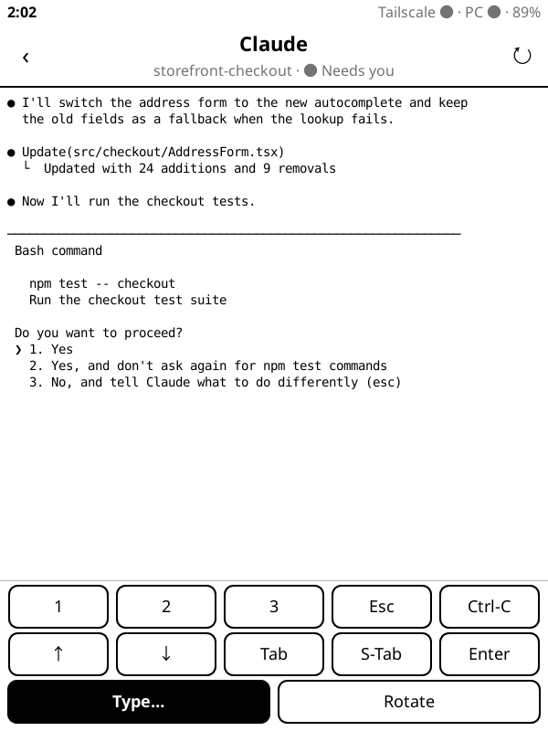
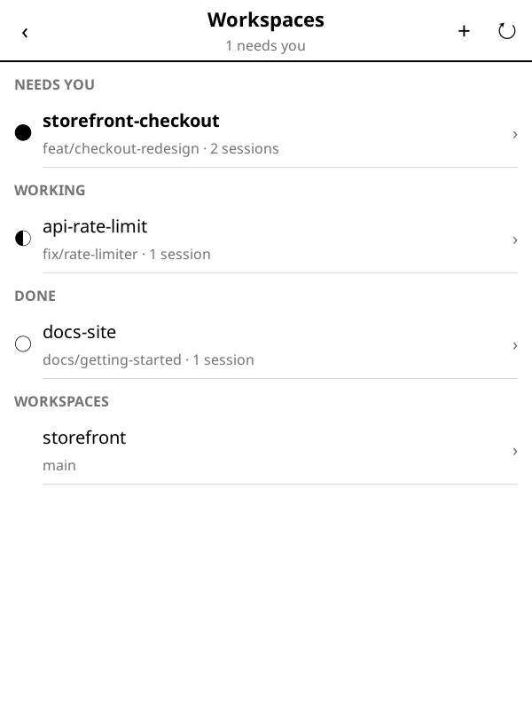
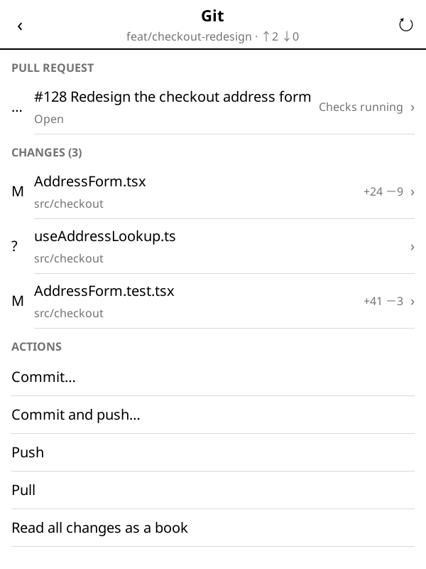
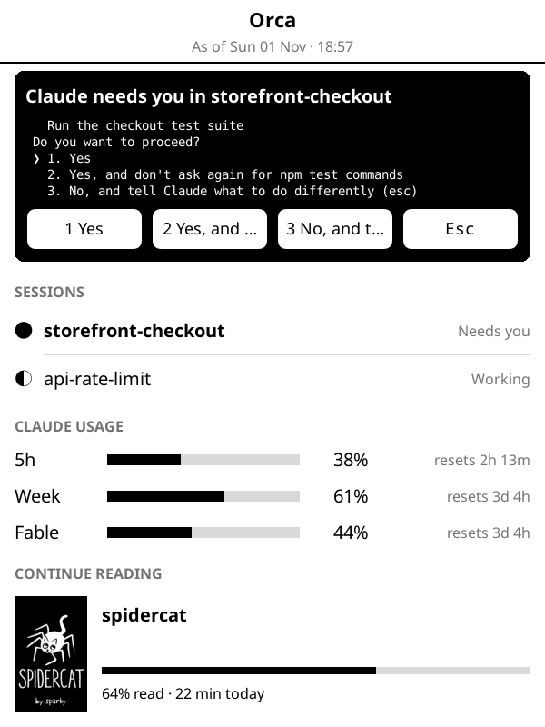
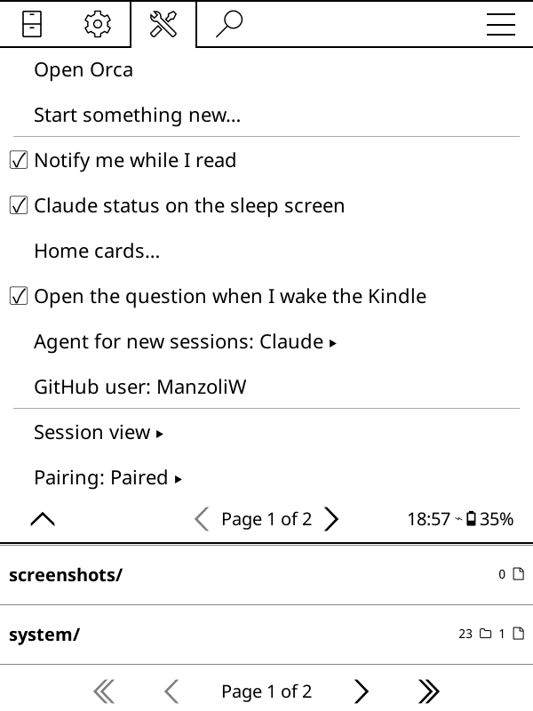
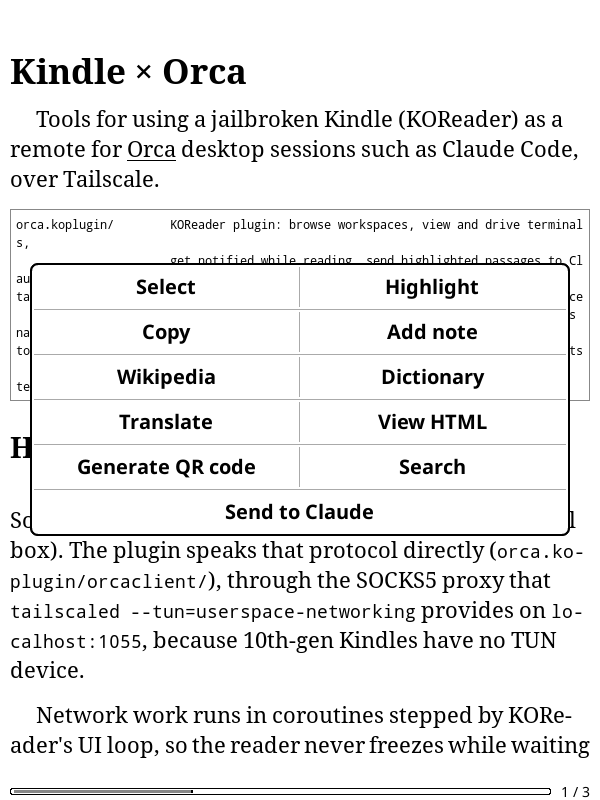
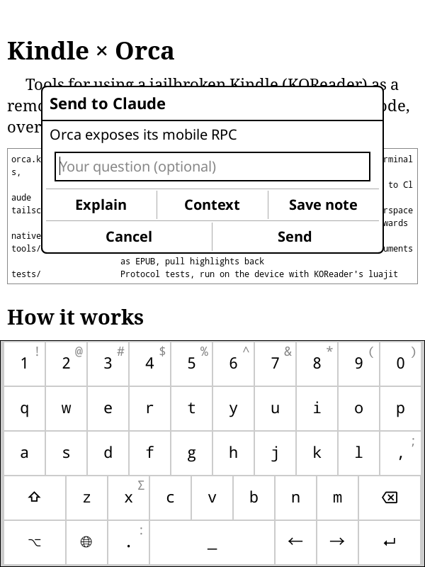

# Kindle × Orca

Use a jailbroken Kindle as an e-ink remote for your
[Orca](https://github.com/stablyai/orca) sessions, such as Claude Code, over
Tailscale. Read a book, get a ping when Claude needs a decision, approve it
with one tap, and go back to reading.

<p align="center">
  
</p>

All screenshots on this page come from a real Kindle Basic (10th gen, 600×800),
captured over SSH with [`tools/kindlectl.py`](tools/README.md).

## What you can do

### Browse workspaces and sessions

Workspaces are sorted by what needs attention first (**needs you** → working →
done), and each terminal shows its agent's state.

<p>
  
  &nbsp;
  
</p>

### Drive a session

The session view shows the terminal's current screen. The desktop resizes that
terminal to the Kindle's width while you're looking at it, so nothing is cut
off, and restores the size when you leave. Buttons cover what Claude Code asks
for most: `1 2 3` for choices, `Esc`, `Ctrl-C`, arrows, `Tab`/`⇧Tab`
(mode switching), `⏎`, and **Type…** for free text. With live updates on, the
screen refreshes when the session prints something.

### Start something new

**+ Start something new** at the top of the workspace list (also in
Tools → Orca) gives four options:

- **New workspace with Claude:** pick a project, say what Claude should do,
  and the workspace opens with Claude already working on it.
- **From a GitHub issue or PR:** browse or search the project's open issues and
  pull requests, tap one, and Claude starts in a workspace linked to it. For a
  PR, the workspace checks out the PR's branch.
- **Clone from GitHub:** type `owner/repo` or a URL. It's cloned on the desktop
  and added to Orca, and you watch the progress in a terminal.
- **New empty project:** creates a folder with a git repository (and an empty
  first commit) and adds it to Orca.

Orca doesn't let phones clone or add projects directly. For those two, the
plugin runs `git` and the `orca` CLI in a desktop terminal. New projects go
next to your existing ones; change the folder with **Folder…**.

### Work inside a workspace

Opening a workspace shows these rows above its terminals:

- **+ New Claude session** (with an optional first prompt) and **+ New shell**.
- **Git:** branch and ahead/behind, the changed files (tap one for its diff),
  **Commit all** (with a message drafted by the desktop's agent, which you can
  edit) and **Commit & push**, **Push**, **Pull**, **Open a pull request**
  (normal or draft), and **Read all changes as a book**, which opens every diff
  as one document in KOReader.
- **Pull request:** when the branch already has one, the Git screen shows it
  with its checks (✓ ✗ …). Tap a check for its failing steps and annotations;
  **Re-run the failed checks**, **Ask Claude to fix the failures** (starts a
  session in the workspace with the failing check names), or **Merge…**
  (squash, merge commit or rebase).
- **Files:** browse the checkout and read any file. **Open as book** saves it
  to `documents/Claude/`; **Ask Claude…** sends a question about it to a session.
- **Workspace:** put it to sleep, or remove it (the branch is kept).

<p>
  
</p>

### Claude status on the sleep screen

With **Claude status on the sleep screen** on, the plugin keeps KOReader's
sleep message up to date while the Kindle is awake, so the sleeping Kindle
shows Claude's usage and your sessions:

<p>
  
</p>

The limits are Claude's own 5-hour and weekly limits, as Orca's accounts
screen shows them, followed by the most recent conversation and its total
tokens. Turning the option off restores your previous sleep message.
**Orca stats** in the same menu shows agents started, pull requests and total
agent time.

### Recent conversations

**Recent conversations** (in the menu and at the top of the workspace list)
lists your latest agent conversations across all projects, with their size in
tokens. Open one to see its latest messages, read them as a book, or
**Continue on desktop**, which runs `claude --resume` in that project's
workspace and opens it on the Kindle.

### Get notified while you read

With **Notify me while I read** on, the plugin checks your sessions in the
background (every 30 s by default). When one hits a permission prompt or
finishes its work, a popup appears over your book. For a prompt, the popup
shows the question itself with **1 2 3 Esc** buttons, so you can answer
without leaving the book; **Open** goes straight to that session. When the
Kindle wakes up, it also tells you what finished or
started waiting while it was asleep.

<p>
  
</p>

<p>
  
</p>

### Send a passage to Claude

Select text in any book and the highlight menu gets a **Send to Claude**
button. Pick a preset (**Explain**, **Context**, **Save note**) or type your
own question. The passage is sent to your last-used session along with the
book title, author and chapter, and the session view opens so you can read the
answer.

<p>
  
  &nbsp;
  
</p>
<p>
  
  &nbsp;
  
</p>

What arrives in Claude Code:

```
From Kindle x Orca by Claude, chapter "Kindle × Orca":

"Orca exposes its mobile RPC on"

Explain this passage in a few short paragraphs.
```

### Send documents from Claude to the Kindle

`tools/send_to_kindle.py` turns Markdown (plans, reviews, reports, diffs) into
an EPUB that reads well on e-ink and copies it to `documents/Claude/` over
Tailscale, or over USB when the Kindle is plugged in. In Claude Code, the
`/send-to-kindle` skill does this for you. `tools/pull_notes.py` brings your
KOReader highlights and notes back as Markdown.

<p>
  
</p>

```sh
python tools/send_to_kindle.py plan.md --title "Refactor plan"
git diff main | python tools/send_to_kindle.py - --title "Review: my-branch"
python tools/pull_notes.py --since 2026-10-01 --out notes.md
```

## Setup

You need a jailbroken Kindle with [KOReader](https://github.com/koreader/koreader),
Tailscale on both the Kindle and the PC, and Orca running on the PC.

1. **Install KOReader** via KPM: `;kpm install koreader`.
2. **Copy both plugins** into `koreader/plugins/` on the Kindle:
   `tailscale.koplugin/` and `orca.koplugin/`.
3. **Start Tailscale on the Kindle**: KOReader → Network → Tailscale → Setup
   (auth key, binaries), then **Start Service and Connect**. It starts by
   itself with KOReader after that.
4. **Pair with Orca**: on the PC, Orca → Settings → Mobile. Save the pairing
   link to `/mnt/us/orca-pairing.txt` on the Kindle, then KOReader → Tools →
   Orca → Pairing → **Import**. The file is deleted after import.
5. **Test it**: Tools → Orca → Connection → **Test connection**. It reports
   either the number of workspaces found or the step that failed.

> The pairing link is a device credential. Keep it out of chats, screenshots
> and repositories. Revoke it in Orca → Settings → Mobile if it leaks.

## How it works

```
Kindle (KOReader)                                   PC
┌──────────────────────┐                        ┌──────────────────┐
│ orca.koplugin        │  WebSocket, NaCl box   │ Orca             │
│  └ orcaclient/       │ ─────────────────────▶ │  mobile RPC      │
│ tailscaled           │   SOCKS5 :1055 →       │  :6768           │
│  (userspace mode)    │   tailnet              │                  │
└──────────────────────┘                        └──────────────────┘
```

- **Protocol**: the plugin speaks Orca's mobile protocol directly: a WebSocket
  on port 6768 with an end-to-end encrypted handshake (X25519 +
  XSalsa20-Poly1305, via a TweetNaCl build for the Kindle in
  `native/tweetnacl/`).
- **Networking**: 10th-gen Kindles have no TUN device, so `tailscaled` runs in
  userspace mode and apps reach the tailnet through its SOCKS5 proxy on
  `localhost:1055`. The patched Tailscale plugin sets that up, and can also
  forward local ports so KOReader's own OPDS/Calibre browser can reach the PC
  (Tailscale → Advanced → Local port forwards).
- **No freezes**: network work runs in coroutines stepped by KOReader's UI
  loop, so the reader stays responsive while waiting on the network.

## Repository layout

| Path | What |
| --- | --- |
| `orca.koplugin/` | KOReader plugin: sessions, notifications, Send to Claude |
| `orca.koplugin/orcaui/` | New workspaces, clone, git, files (`workspace.lua`); recent conversations; sleep screen; line diff |
| `tailscale.koplugin/` | Tailscale plugin, patched for kernels without TUN; autostart; port forwards |
| `native/tweetnacl/` | NaCl cross-build for armv7 (`build.sh`, needs Zig) |
| `tools/` | PC side: `kindlectl.py` (screenshot/tap over SSH), `send_to_kindle.py`, `pull_notes.py` |
| `tests/` | Protocol tests, run on the Kindle with KOReader's `luajit`; `rpc_probe.lua` calls every RPC the menus use against the real desktop; `pc_ui_test.lua` runs the menus on a PC against a fake Orca |
| `.claude/skills/` | `send-to-kindle` skill for Claude Code |

## Tested on

Kindle Basic (KT4, 10th gen), firmware 5.18.1.1.1, KOReader 2026.07.1, Orca
desktop on Windows 11. Other Kindles that run KOReader should work. The
touch-injection tool (`kindlectl`) may need its profile adjusted on other
models (see `tools/README.md`).
